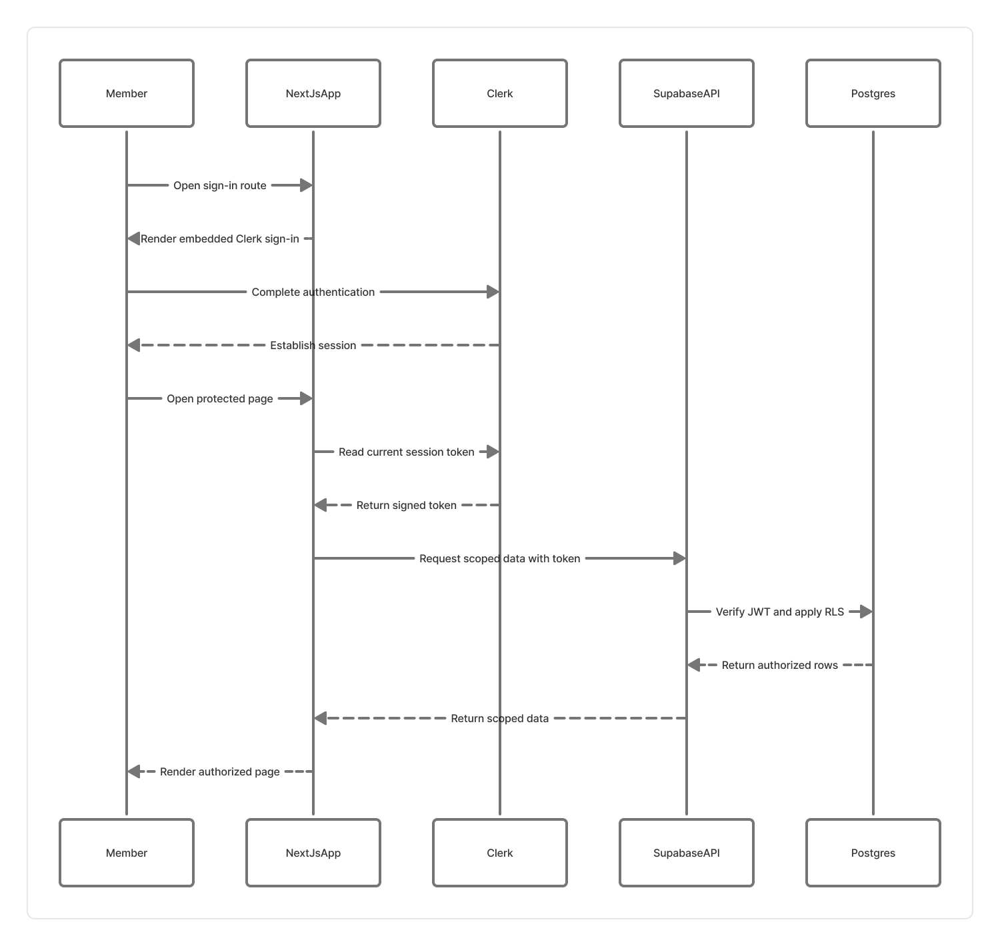

# Authentication and permissions

## Request lifecycle

1. Clerk verifies the user's identity and signs the session token.
2. Clerk middleware establishes the session for Next.js routes. Server and browser Supabase clients pass the Clerk token to Supabase Third-Party Auth.
3. `private.current_profile_id()` maps the signed Clerk subject to the stable application UUID in `profiles.id`. Migrated Clerk users use their existing profile UUID as `external_id`; new users link through `profiles.clerk_user_id`.
4. The app reads current role grants from Postgres. Row-level security and scope-aware database functions re-check every protected operation.
5. The UI uses permission results to show relevant management areas; it does not authorize requests.

The Supabase publishable key is safe to expose. Never use a Supabase service/secret key in browser code or ordinary frontend request handlers.

## Authentication flows

[Open the sign-in and data-access sequence in Figma](https://www.figma.com/board/gAGnPMmSaABH8jC6riESPs?node-id=2-43)

- `/auth/sign-up` and `/auth/sign-in` use Clerk's hosted widgets embedded in the site.
- Clerk owns email verification, password recovery, active sessions, invitations, and account suspension.
- `/account/settings` keeps profile fields in Supabase and opens Clerk's account UI for sign-in methods and devices.
- A normal Clerk account does not grant society membership or an admin role.
- On the first authenticated request, the app creates or links the user's stable `profiles` row.

Configure Clerk redirects and email verification in Clerk. Configure Supabase Third-Party Auth to trust the same Clerk instance. See [Operations and deployment](operations.md) and the [Clerk cutover checklist](auth-migration-checklist.md).

## Membership scope

Anyone can register a normal account with email/password. Only a Society Admin can add or activate an account as a society member; direct writes, approvals, and removals for society-wide membership rows are protected by database policies and an admin-checked RPC. An account must exist and have a verified email before it can be added. Users can request membership in one of the five clubs, and a manager can approve/reject requests only within the assigned club scope. Pending requests do not grant member-only content access. Only active memberships count for private events and team records.

A club manager's permissions do not transfer to another club. Society-scoped roles require a null club scope; club roles require a concrete matching club.

## Capabilities

| Key | Purpose |
| --- | --- |
| admin.manage | Manage roles, existing permission grants, invitations, direct role assignments, and administrative private-profile access. |
| clubs.manage | Manage club data and activation. |
| positions.manage | Manage position definitions within the permitted society/club scope. |
| members.manage | Review and update membership records in scope. |
| events.manage | Manage events in scope. |
| registrations.manage | Read and update event registrations in scope. |
| team.manage | Manage team directory entries in scope. |
| alumni.manage | Manage alumni entries in scope. |
| contacts.manage | Read and update the contact inbox within the assigned society or club scope. |
| content.manage | Manage published website content and public website media. |

Capabilities are granted by database roles. A permission key is schema-managed, while role-to-permission assignments can be configured by an admin. The backend repository's bootstrap script assigns the first Society Admin; public signup never grants privileges.

## Edge cases handled

- Missing Supabase configuration returns an unavailable state instead of silently using privileged access.
- Invalid callback destinations are rejected to prevent open redirects.
- Manager permissions are reloaded from Postgres, and database policy checks still run on writes.
- Repeated membership or registration requests can conflict with unique constraints; the UI reports a refresh/retry message rather than assuming success.
- Membership approval actions require the request to remain pending.
- Manager registration status transitions use the previously-read status to reject stale updates.
- Sign-up confirmation may create an account without an active session; the UI asks the user to confirm email before signing in.
