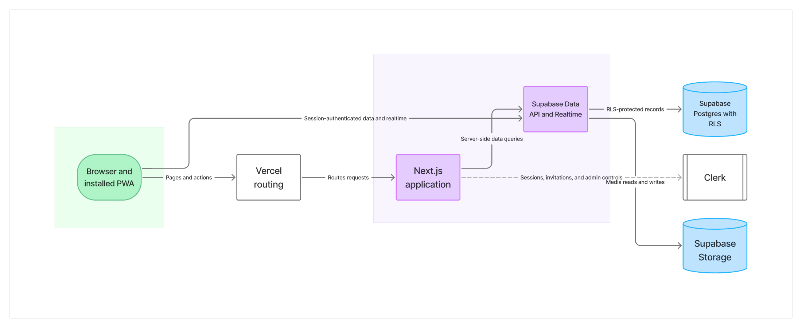
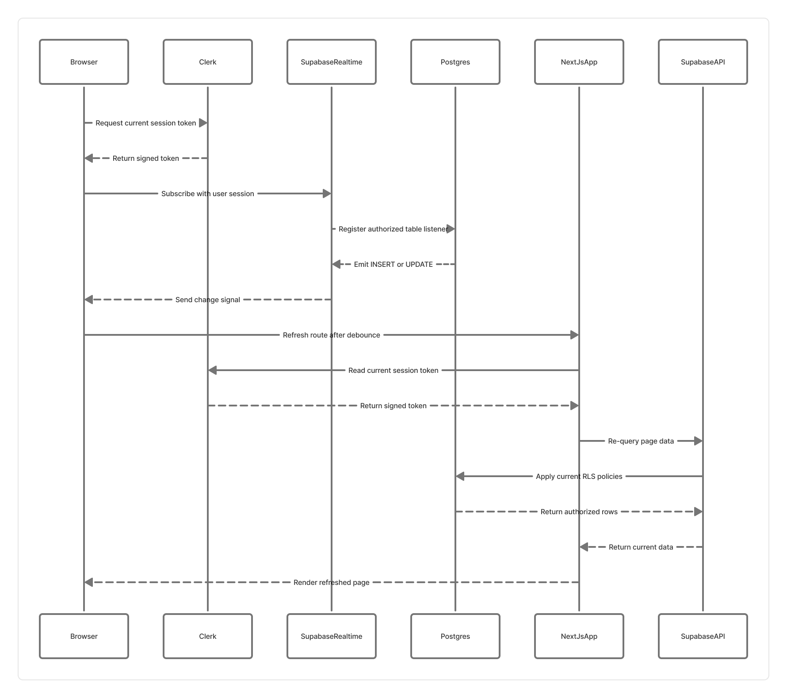

# System diagrams

The diagrams below describe the main request and data flows in the Techtronica application. The [Figma FigJam board](https://www.figma.com/board/gAGnPMmSaABH8jC6riESPs) contains editable versions. PNG previews are committed here so the documentation remains readable without Figma; the Mermaid source is kept alongside the docs as a text fallback.

## Application architecture

[Open the architecture diagram in Figma](https://www.figma.com/board/gAGnPMmSaABH8jC6riESPs?node-id=1-2)

## Clerk sign-in and protected data

[Open the sign-in sequence in Figma](https://www.figma.com/board/gAGnPMmSaABH8jC6riESPs?node-id=2-43)

~~~mermaid
sequenceDiagram
    title Clerk sign-in and protected data request
    participant Member
    participant NextJsApp
    participant Clerk
    participant SupabaseAPI
    participant Postgres

    Member->>NextJsApp: Open sign-in route
    NextJsApp-->>Member: Render embedded Clerk sign-in
    Member->>Clerk: Complete authentication
    Clerk-->>Member: Establish session
    Member->>NextJsApp: Open protected page
    NextJsApp->>Clerk: Read current session token
    Clerk-->>NextJsApp: Return signed token
    NextJsApp->>SupabaseAPI: Request scoped data with token
    SupabaseAPI->>Postgres: Verify JWT and apply RLS
    Postgres-->>SupabaseAPI: Return authorized rows
    SupabaseAPI-->>NextJsApp: Return scoped data
    NextJsApp-->>Member: Render authorized page
~~~

## Realtime change and page refresh

[Open the realtime sequence in Figma](https://www.figma.com/board/gAGnPMmSaABH8jC6riESPs?node-id=3-114)

~~~mermaid
sequenceDiagram
    title Realtime change and authorized page refresh
    participant Browser
    participant Clerk
    participant SupabaseRealtime
    participant Postgres
    participant NextJsApp
    participant SupabaseAPI

    Browser->>Clerk: Request current session token
    Clerk-->>Browser: Return signed token
    Browser->>SupabaseRealtime: Subscribe with user session
    SupabaseRealtime->>Postgres: Register authorized table listener
    Postgres-->>SupabaseRealtime: Emit INSERT or UPDATE
    SupabaseRealtime-->>Browser: Send change signal
    Browser->>NextJsApp: Refresh route after debounce
    NextJsApp->>Clerk: Read current session token
    Clerk-->>NextJsApp: Return signed token
    NextJsApp->>SupabaseAPI: Re-query page data
    SupabaseAPI->>Postgres: Apply current RLS policies
    Postgres-->>SupabaseAPI: Return authorized rows
    SupabaseAPI-->>NextJsApp: Return current data
    NextJsApp-->>Browser: Render refreshed page
~~~

## Keeping diagrams current

When a change affects identity, data access, authorization, or realtime behavior, update the Mermaid source and the corresponding FigJam diagram together. Re-export the changed FigJam section to docs/images/ so README and docs previews stay in sync. The database remains the authorization boundary: diagram arrows do not imply that a client can bypass Row Level Security.
